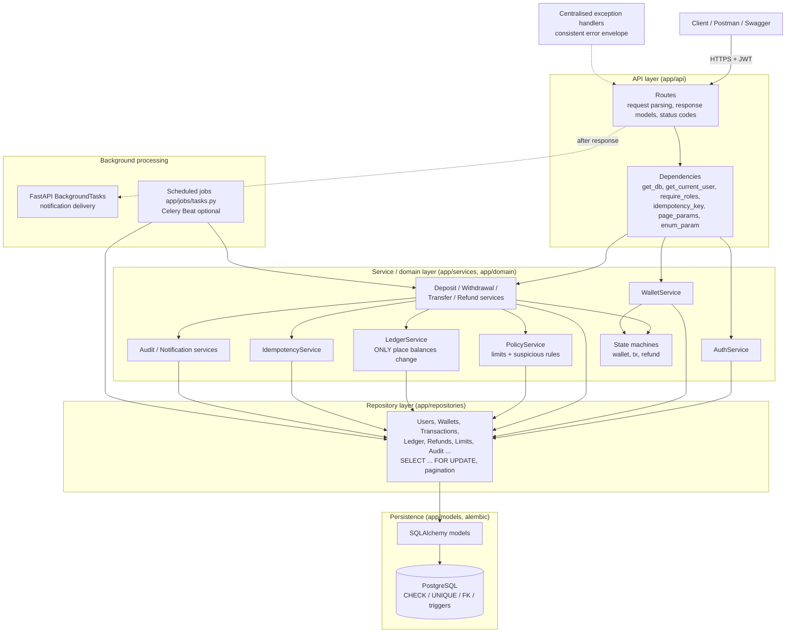
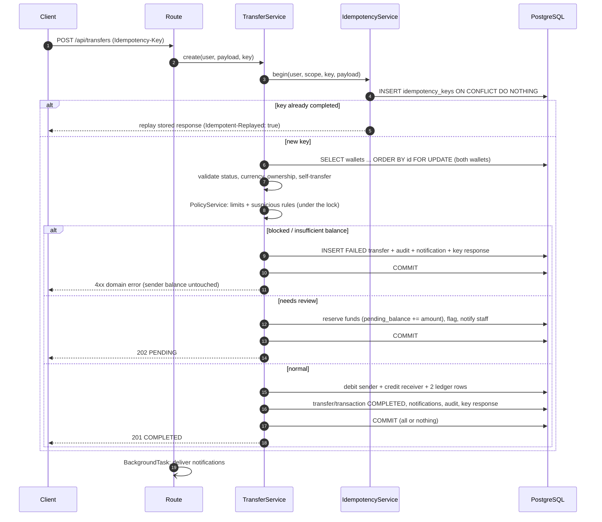
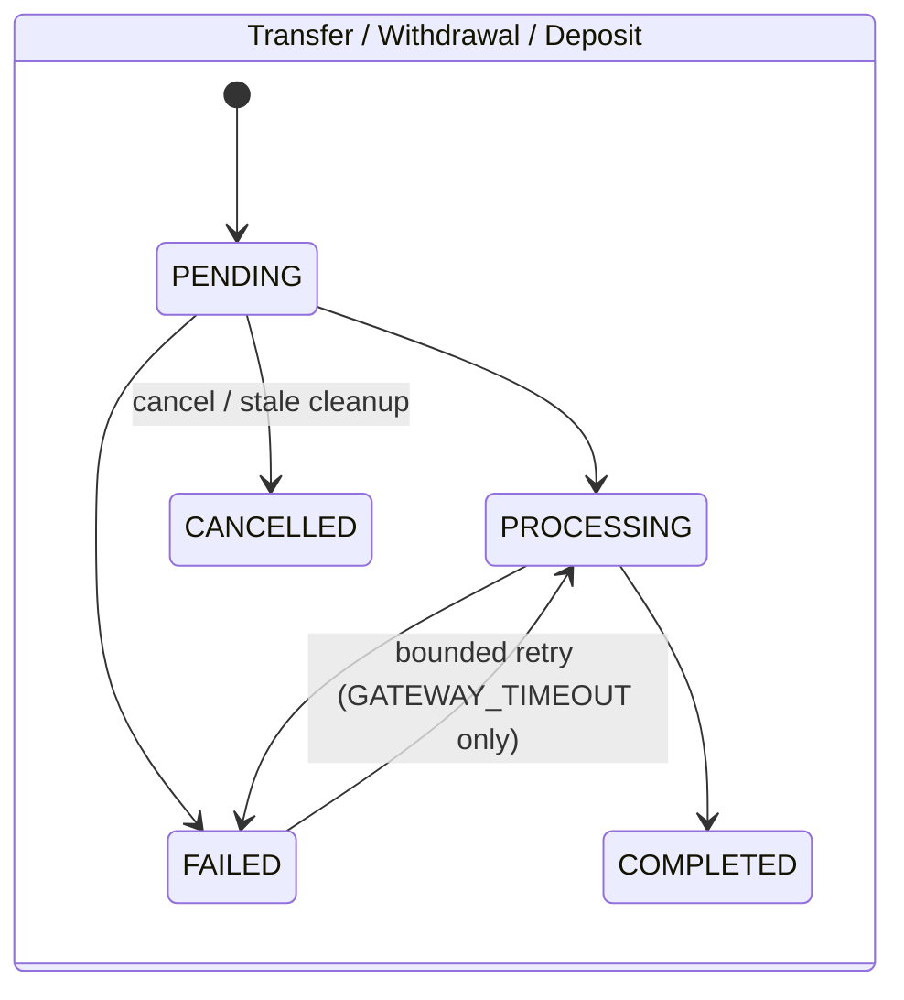
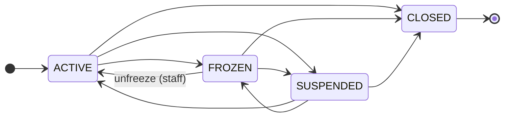
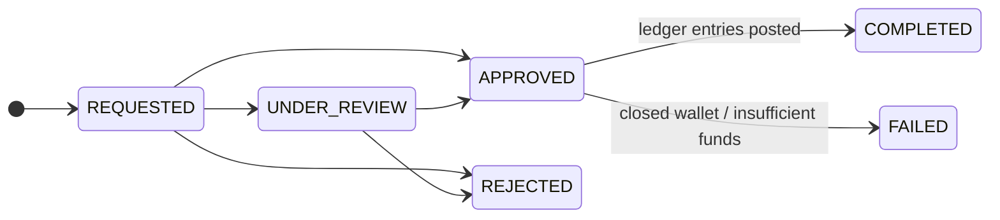

# Architecture

## Layered design

Business rules live in the **service / domain layer**. Route handlers only translate HTTP <-> use-cases;
repositories only contain queries and row locking.

## Anatomy of a transfer (one DB transaction)

## State machines

## Request-level security pipeline

1. `HTTPBearer` extracts the token -> `AuthService.authenticate` verifies signature, expiry, **type = access**,
   that the user exists and **is active**, and that the **session (token family) has not been revoked**.
2. `require_roles(...)` enforces **role-based** access (403 `ROLE_NOT_ALLOWED`).
3. Services enforce **resource-based** rules: wallet ownership, transfer participants, refund requester, who may
   cancel what, who may change which wallet status (403 `*_ACCESS_DENIED`).
4. Business invariants (state machines, limits, balances) are enforced in services and re-checked by DB constraints.
