# ER Diagram & Database Design

> The diagram and the constraint catalogue below are **generated from the SQLAlchemy models**
> (`python -m scripts.generate_er`), so they always match the schema created by Alembic.
> GitHub renders the Mermaid block natively.

## Entity-relationship diagram

```mermaid
erDiagram
    audit_logs {
        uuid id PK
        uuid user_id FK
        varchar_60 action
        varchar_40 entity
        varchar_64 entity_id
        varchar_64 ip_address
        jsonb metadata
        timestamptz created_at
    }
    deposits {
        uuid wallet_id FK
        enum status
        uuid created_by FK
        uuid id PK
        numeric_18_2 amount
        varchar_3 currency
        varchar_40 reference_number UK
        varchar_100 failure_reason
        int retry_count
        timestamptz created_at
        timestamptz updated_at
        timestamptz completed_at
    }
    idempotency_keys {
        uuid id PK
        uuid user_id FK
        varchar_64 scope
        varchar_255 key
        varchar_64 request_hash
        enum state
        int response_status
        jsonb response_body
        uuid resource_id
        timestamptz created_at
    }
    notifications {
        uuid id PK
        uuid user_id FK
        enum type
        varchar_150 title
        text message
        bool is_read
        timestamptz read_at
        timestamptz delivered_at
        jsonb metadata
        timestamptz created_at
    }
    refresh_tokens {
        uuid id PK
        varchar_64 jti UK
        uuid user_id FK
        uuid family_id
        timestamptz expires_at
        timestamptz revoked_at
        varchar_64 replaced_by_jti
        varchar_64 ip_address
        timestamptz created_at
    }
    refunds {
        uuid id PK
        uuid transaction_id FK
        uuid wallet_id FK
        uuid requested_by FK
        numeric_18_2 amount
        varchar_3 currency
        varchar_500 reason
        enum status
        varchar_40 reference_number UK
        uuid reviewed_by FK
        timestamptz reviewed_at
        varchar_500 review_notes
        varchar_100 failure_reason
        uuid refund_transaction_id
        timestamptz created_at
        timestamptz updated_at
        timestamptz completed_at
    }
    roles {
        int id PK
        enum name UK
        varchar_255 description
    }
    suspicious_transactions {
        uuid id PK
        uuid transaction_id FK, UK
        uuid wallet_id FK
        enum risk_status
        jsonb reasons
        enum review_status
        uuid reviewed_by FK
        timestamptz reviewed_at
        varchar_500 review_notes
        timestamptz created_at
    }
    transaction_ledger {
        uuid id PK
        uuid wallet_id FK
        uuid transaction_id FK
        enum transaction_type
        enum direction
        numeric_18_2 amount
        numeric_18_2 balance_before
        numeric_18_2 balance_after
        varchar_30 reference_entity
        uuid reference_id
        varchar_255 description
        uuid created_by FK
        timestamptz created_at
        jsonb metadata
    }
    transaction_limits {
        int id PK
        numeric_18_2 max_transaction_amount
        numeric_18_2 daily_transfer_limit
        numeric_18_2 daily_withdrawal_limit
        int max_transactions_per_day
        numeric_18_2 suspicious_amount_threshold
        int velocity_window_minutes
        int velocity_review_count
        int velocity_block_count
        int frequency_review_threshold
        int recently_frozen_hours
        uuid updated_by FK
        timestamptz updated_at
    }
    transactions {
        uuid id PK
        enum type
        enum status
        enum risk_status
        uuid wallet_id FK
        uuid counterparty_wallet_id FK
        numeric_18_2 amount
        varchar_3 currency
        varchar_40 reference_number UK
        varchar_30 reference_entity
        uuid reference_id
        varchar_255 description
        uuid created_by FK
        timestamptz created_at
        timestamptz updated_at
        timestamptz completed_at
    }
    transfers {
        uuid sender_wallet_id FK
        uuid receiver_wallet_id FK
        enum status
        varchar_255 note
        uuid created_by FK
        uuid id PK
        numeric_18_2 amount
        varchar_3 currency
        varchar_40 reference_number UK
        varchar_100 failure_reason
        int retry_count
        timestamptz created_at
        timestamptz updated_at
        timestamptz completed_at
    }
    users {
        uuid id PK
        varchar_255 email
        varchar_120 full_name
        varchar_255 hashed_password
        int role_id FK
        bool is_active
        timestamptz last_login_at
        timestamptz created_at
        timestamptz updated_at
    }
    wallet_balances {
        uuid wallet_id PK, FK
        numeric_18_2 available_balance
        numeric_18_2 pending_balance
        timestamptz updated_at
    }
    wallets {
        uuid id PK
        uuid user_id FK
        varchar_100 name
        varchar_3 currency
        enum status
        timestamptz last_frozen_at
        timestamptz closed_at
        timestamptz created_at
        timestamptz updated_at
    }
    withdrawals {
        uuid wallet_id FK
        enum status
        varchar_255 destination
        uuid created_by FK
        uuid id PK
        numeric_18_2 amount
        varchar_3 currency
        varchar_40 reference_number UK
        varchar_100 failure_reason
        int retry_count
        timestamptz created_at
        timestamptz updated_at
        timestamptz completed_at
    }
    users |o--o{ audit_logs : "user_id"
    wallets ||--o{ deposits : "wallet_id"
    users |o--o{ deposits : "created_by"
    users ||--o{ idempotency_keys : "user_id"
    users ||--o{ notifications : "user_id"
    users ||--o{ refresh_tokens : "user_id"
    transactions ||--o{ refunds : "transaction_id"
    wallets ||--o{ refunds : "wallet_id"
    users ||--o{ refunds : "requested_by"
    users |o--o{ refunds : "reviewed_by"
    transactions ||--o| suspicious_transactions : "transaction_id"
    wallets ||--o{ suspicious_transactions : "wallet_id"
    users |o--o{ suspicious_transactions : "reviewed_by"
    wallets ||--o{ transaction_ledger : "wallet_id"
    transactions |o--o{ transaction_ledger : "transaction_id"
    users |o--o{ transaction_ledger : "created_by"
    users |o--o{ transaction_limits : "updated_by"
    wallets ||--o{ transactions : "wallet_id"
    wallets |o--o{ transactions : "counterparty_wallet_id"
    users |o--o{ transactions : "created_by"
    wallets ||--o{ transfers : "sender_wallet_id"
    wallets ||--o{ transfers : "receiver_wallet_id"
    users |o--o{ transfers : "created_by"
    roles ||--o{ users : "role_id"
    wallets ||--o| wallet_balances : "wallet_id"
    users ||--o{ wallets : "user_id"
    wallets ||--o{ withdrawals : "wallet_id"
    users |o--o{ withdrawals : "created_by"
```

## Design explanation

**Identity & access** - `users` (role FK to `roles`, case-insensitive unique e-mail via a `lower(email)` index,
`is_active` flag) and `refresh_tokens`. Each login creates a *token family* (`family_id` = session id). Refresh tokens
are single-use: rotating marks the old row `revoked_at` and links `replaced_by_jti`. Presenting an already-revoked
token revokes the whole family (theft detection). Access tokens carry the family id, so logout / password change /
deactivation invalidate them immediately, not only when they expire.

**Wallets & balances** - `wallets` hold identity and status (`ACTIVE | FROZEN | SUSPENDED | CLOSED`, enforced by a
CHECK constraint **and** a transition table in `app/domain/state_machines.py`). Money lives in a separate
`wallet_balances` row (1:1) with `available_balance` and `pending_balance`. `pending_balance` is the part of
`available_balance` *reserved* for outgoing transactions that are held for review, so
`spendable = available - pending`. Three CHECK constraints make illegal states unrepresentable:
`available >= 0`, `pending >= 0`, `pending <= available`.

**Money movement** - `deposits`, `withdrawals`, `transfers` carry domain-specific fields and their own status. Every one
of them is mirrored by exactly one row in the unified **`transactions`** table (type, status, risk status, wallet,
counterparty, amount, reference). This is what history, filtering, limits and monitoring query, and what refunds
point at (`reference_entity` + `reference_id` tie it back to the domain row). Refunds and manual adjustments also
create a `transactions` row.

**Immutable ledger** - `transaction_ledger` is append-only: one row per available-balance change, with
`balance_before`, `balance_after`, direction and a JSONB `metadata`. A CHECK constraint enforces the arithmetic
(`CREDIT: after = before + amount`, `DEBIT: after = before - amount`). A `BEFORE UPDATE OR DELETE` trigger rejects
mutation at the database level (`audit_logs` has the same trigger) and an ORM event listener rejects it in the
application. Balance == sum(credits) - sum(debits) for every wallet, which the concurrency tests assert.

**Refunds** - a **partial unique index** (`uq_refunds_one_active_per_transaction`) allows at most one *live*
(`REQUESTED/UNDER_REVIEW/APPROVED/COMPLETED`) refund per original transaction. Duplicate refunds are therefore
impossible even under a race; `REJECTED`/`FAILED` refunds free the slot for a new request.

**Limits & monitoring** - `transaction_limits` is a singleton row (`CHECK id = 1`) holding limits *and* the
suspicious-activity thresholds, editable by admins (changes are audited with before/after values).
`suspicious_transactions` records each flagged transaction with its reasons and review state.

**Idempotency** - `idempotency_keys` has `UNIQUE (user_id, scope, key)`, the SHA-256 of the request payload and the
stored response. It is written in the *same DB transaction* as the money movement, so a key exists if and only if the
movement committed.

**Cross-cutting** - `notifications` (per-user, `delivered_at` set by the background dispatcher) and `audit_logs`
(user, action, entity, entity id, IP, JSONB metadata). All primary keys are UUIDs; all money columns are
`NUMERIC(18,2)`; timestamps are `timestamptz` with server defaults; `updated_at` uses `onupdate`.

**Cascading rules** - financial history is protected: wallets, transactions, ledger, refunds use `ON DELETE RESTRICT`
(you cannot delete a user/wallet that has financial records). `wallet_balances` cascades from its wallet,
`refresh_tokens`/`notifications`/`idempotency_keys` cascade from the user, and audit/creator references use
`SET NULL` so deleting an account never destroys the audit trail.

## Constraint & index catalogue

**`audit_logs`**
- FK (user_id) -> users ON DELETE SET NULL
- INDEX `ix_audit_action` (action)
- INDEX `ix_audit_entity` (entity, entity_id)
- INDEX `ix_audit_user_created` (user_id, created_at)

**`deposits`**
- CHECK `ck_deposits_amount_positive`: `amount > 0`
- CHECK `ck_deposits_txstatus`: status/type is one of the enum values
- UNIQUE (reference_number)
- FK (created_by) -> users ON DELETE SET NULL
- FK (wallet_id) -> wallets ON DELETE RESTRICT
- INDEX `ix_deposits_status` (status)
- INDEX `ix_deposits_wallet_created` (wallet_id, created_at)

**`idempotency_keys`**
- CHECK `ck_idempotency_keys_idempotencystate`: status/type is one of the enum values
- UNIQUE (user_id, scope, key)
- FK (user_id) -> users ON DELETE CASCADE
- INDEX `ix_idempotency_created` (created_at)

**`notifications`**
- CHECK `ck_notifications_notificationtype`: status/type is one of the enum values
- FK (user_id) -> users ON DELETE CASCADE
- INDEX `ix_notifications_undelivered` (delivered_at)
- INDEX `ix_notifications_user_read` (user_id, is_read, created_at)

**`refresh_tokens`**
- UNIQUE (jti)
- FK (user_id) -> users ON DELETE CASCADE
- INDEX `ix_refresh_tokens_family_id` (family_id)
- INDEX `ix_refresh_tokens_user_id` (user_id)

**`refunds`**
- CHECK `ck_refunds_amount_positive`: `amount > 0`
- CHECK `ck_refunds_refundstatus`: status/type is one of the enum values
- UNIQUE (reference_number)
- FK (wallet_id) -> wallets ON DELETE RESTRICT
- FK (transaction_id) -> transactions ON DELETE RESTRICT
- FK (reviewed_by) -> users ON DELETE SET NULL
- FK (requested_by) -> users ON DELETE RESTRICT
- INDEX `ix_refunds_status` (status)
- UNIQUE INDEX `uq_refunds_one_active_per_transaction` (transaction_id) WHERE status IN ('REQUESTED','UNDER_REVIEW','APPROVED','COMPLETED')

**`roles`**
- CHECK `ck_roles_rolename`: status/type is one of the enum values
- UNIQUE (name)

**`suspicious_transactions`**
- CHECK `ck_suspicious_transactions_reviewstatus`: status/type is one of the enum values
- CHECK `ck_suspicious_transactions_riskstatus`: status/type is one of the enum values
- UNIQUE (transaction_id)
- FK (transaction_id) -> transactions ON DELETE RESTRICT
- FK (wallet_id) -> wallets ON DELETE RESTRICT
- FK (reviewed_by) -> users ON DELETE SET NULL
- INDEX `ix_suspicious_review_status` (review_status)
- INDEX `ix_suspicious_wallet` (wallet_id)

**`transaction_ledger`**
- CHECK `ck_transaction_ledger_amount_positive`: `amount > 0`
- CHECK `ck_transaction_ledger_balance_arithmetic`: `(direction = 'CREDIT' AND balance_after = balance_before + amount) OR (direction = 'DEBIT' AND balance_after = balance_before - amount)`
- CHECK `ck_transaction_ledger_balances_non_negative`: `balance_before >= 0 AND balance_after >= 0`
- CHECK `ck_transaction_ledger_direction`: status/type is one of the enum values
- CHECK `ck_transaction_ledger_ledgertype`: status/type is one of the enum values
- FK (transaction_id) -> transactions ON DELETE RESTRICT
- FK (wallet_id) -> wallets ON DELETE RESTRICT
- FK (created_by) -> users ON DELETE SET NULL
- INDEX `ix_ledger_transaction` (transaction_id)
- INDEX `ix_ledger_wallet_created` (wallet_id, created_at)

**`transaction_limits`**
- CHECK `ck_transaction_limits_positive_limits`: `max_transaction_amount > 0 AND daily_transfer_limit > 0 AND daily_withdrawal_limit > 0 AND max_transactions_per_day > 0`
- CHECK `ck_transaction_limits_singleton`: `id = 1`
- FK (updated_by) -> users ON DELETE SET NULL

**`transactions`**
- CHECK `ck_transactions_amount_positive`: `amount > 0`
- CHECK `ck_transactions_riskstatus`: status/type is one of the enum values
- CHECK `ck_transactions_transactiontype`: status/type is one of the enum values
- CHECK `ck_transactions_txstatus`: status/type is one of the enum values
- UNIQUE (reference_number)
- FK (counterparty_wallet_id) -> wallets ON DELETE RESTRICT
- FK (created_by) -> users ON DELETE SET NULL
- FK (wallet_id) -> wallets ON DELETE RESTRICT
- INDEX `ix_transactions_counterparty_created` (counterparty_wallet_id, created_at)
- INDEX `ix_transactions_reference` (reference_entity, reference_id)
- INDEX `ix_transactions_risk` (risk_status)
- INDEX `ix_transactions_type_status` (type, status)
- INDEX `ix_transactions_wallet_created` (wallet_id, created_at)

**`transfers`**
- CHECK `ck_transfers_amount_positive`: `amount > 0`
- CHECK `ck_transfers_distinct_wallets`: `sender_wallet_id <> receiver_wallet_id`
- CHECK `ck_transfers_txstatus`: status/type is one of the enum values
- UNIQUE (reference_number)
- FK (receiver_wallet_id) -> wallets ON DELETE RESTRICT
- FK (created_by) -> users ON DELETE SET NULL
- FK (sender_wallet_id) -> wallets ON DELETE RESTRICT
- INDEX `ix_transfers_receiver_created` (receiver_wallet_id, created_at)
- INDEX `ix_transfers_sender_created` (sender_wallet_id, created_at)
- INDEX `ix_transfers_status` (status)

**`users`**
- FK (role_id) -> roles ON DELETE RESTRICT
- INDEX `ix_users_role_id` (role_id)
- UNIQUE INDEX `uq_users_email_lower` (lower(email))

**`wallet_balances`**
- CHECK `ck_wallet_balances_available_non_negative`: `available_balance >= 0`
- CHECK `ck_wallet_balances_pending_non_negative`: `pending_balance >= 0`
- CHECK `ck_wallet_balances_pending_within_available`: `pending_balance <= available_balance`
- FK (wallet_id) -> wallets ON DELETE CASCADE

**`wallets`**
- CHECK `ck_wallets_currency_iso`: `char_length(currency) = 3 AND currency = upper(currency)`
- CHECK `ck_wallets_walletstatus`: status/type is one of the enum values
- FK (user_id) -> users ON DELETE RESTRICT
- INDEX `ix_wallets_status` (status)
- INDEX `ix_wallets_user_status` (user_id, status)

**`withdrawals`**
- CHECK `ck_withdrawals_amount_positive`: `amount > 0`
- CHECK `ck_withdrawals_txstatus`: status/type is one of the enum values
- UNIQUE (reference_number)
- FK (wallet_id) -> wallets ON DELETE RESTRICT
- FK (created_by) -> users ON DELETE SET NULL
- INDEX `ix_withdrawals_status` (status)
- INDEX `ix_withdrawals_wallet_created` (wallet_id, created_at)
